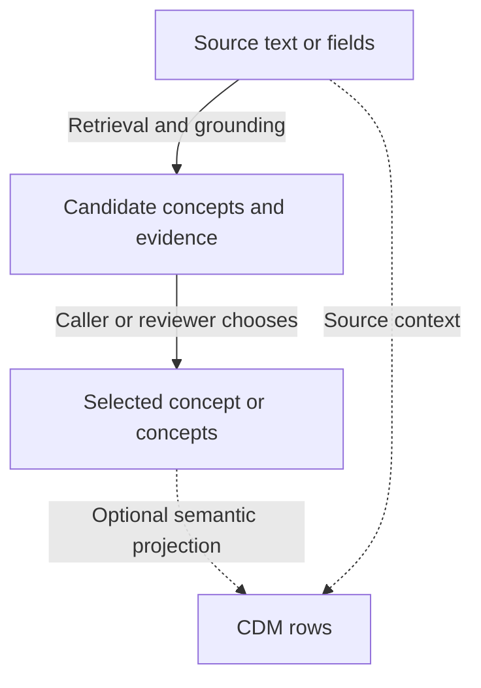
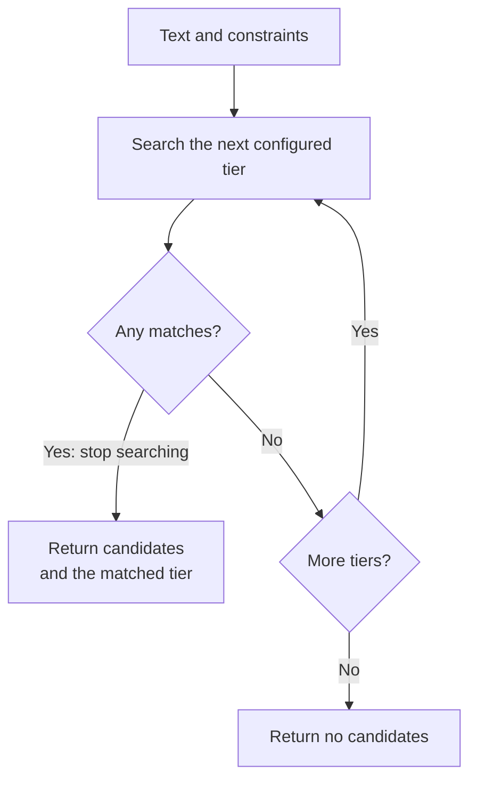
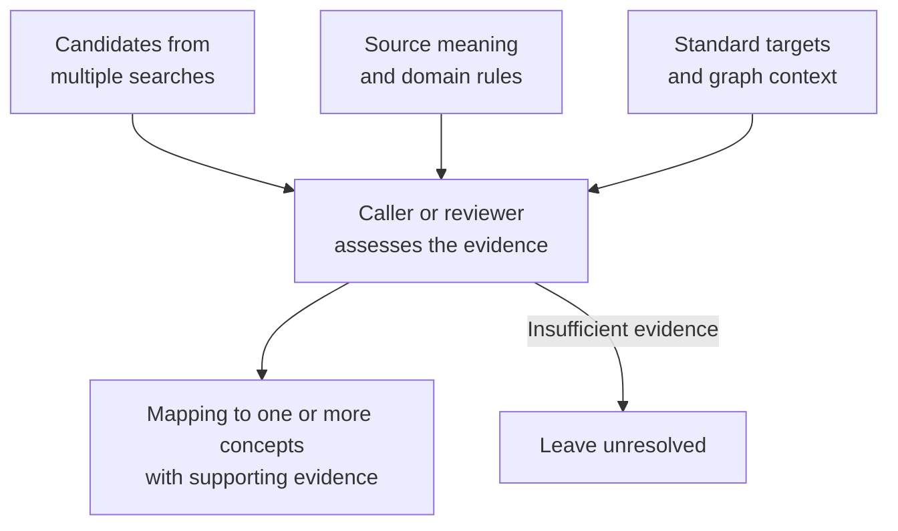

# Concepts and capability choices

Groundworkers provides read-only tools for working with OMOP vocabularies and source metadata. It combines deterministic vocabulary and graph operations with optional retrieval and model-assisted steps, available through MCP, REST, or direct Python.

MCP, REST, and Python are different ways to call the same runtime. Where a service exists, they share its implementation.

## The main workflow

Mapping usually starts with source text or fields. Text preparation or domain classification can help narrow the search. Retrieval finds candidate concepts; grounding tries to resolve the input using ranked rules. Mapping brings the candidates, evidence, and graph context together for a caller or reviewer to choose a mapping. Optional semantic projection then uses the grounded concept and source context to produce CDM rows.

## Grounding, mapping, and retrieval

### Retrieval

Retrieval asks which OMOP concepts resemble an input. Groundworkers exposes several signals:

- exact search matches a complete concept name or synonym;
- normalized search compares deterministic normalized text;
- PostgreSQL full-text search matches indexed terms and returns `ts_rank`;
- embedding search compares a query vector with stored concept vectors.

Use the search tools when you want to choose the strategy yourself and inspect its signals. The search results can include non-standard concepts; that is often useful because source codes and synonyms may have better lexical coverage than their standard targets.

### Grounding

Grounding is a ranked, policy-driven attempt to resolve free text to concepts. `concept_ground` runs its configured tiers in order and stops at the first tier that produces results. It reports the matched tier and whether embedding retrieval was used. Domain, vocabulary, ancestry, standardness, and activity constraints narrow the search.

Grounding is not proof that the first result is the correct mapping. A caller that needs reviewable evidence should use `concept_candidate_bundle`, inspect the candidate union, and add `concept_mapping_context` for the selected concept.

### Mapping

Mapping is the broader decision workflow around a source term. Mapping tools combine retrieval channels, navigate non-standard concepts to standard targets, find broader standard ancestors, assemble graph context, follow `Maps to value` relationships, and evaluate predictions against references. They are useful when the caller must preserve evidence or ask a human or another model to make the final choice.

## Deterministic and model-assisted capabilities

Most vocabulary and graph operations run without an LLM. Some text preparation and classification tasks use a configured model.

| Capability | Deterministic? | Additional infrastructure |
|---|---:|---|
| Concept lookup, hierarchy, relationships, paths, and standard navigation | Yes | OMOP CDM/vocabulary database; graph preparation for some indexes and classified relationships |
| Exact, normalized, and full-text retrieval | Yes | OMOP vocabulary database; full-text sidecars for full-text retrieval |
| Candidate bundles and mapping context | Yes, with optional embedding channel | CDM and graph access; embeddings only for embedding retrieval |
| Embedding search and embedding grounding tier | Query and index operations are deterministic once vectors exist | Populated embedding store plus a configured embedding model for live query encoding |
| Text normalization, cleanup, decomposition, and disambiguation | No | Configured chat model with structured-output support |
| Structured-field domain classification | No | Configured chat model |
| Assisted source planning | Deterministic pipeline plus optional model fallback | LLM only when the assisted path is selected and configured |
| Source planning without assistance | Yes | Source content and any format-specific optional extra |
| Semantic projection | Yes | No database, embedding model, or LLM |

An embedding model and a chat model are separate configuration references. A deployment can use embeddings without enabling chat, chat without embeddings, or neither.

## Source planning and knowledge packs

Source planning analyses an input before ingestion. It decomposes the input, normalizes its structure, annotates columns, and returns results such as column roles, domain hints, warnings, and an ingestion strategy. The caller manages session state and job persistence. `groundcrew` uses this capability.

The deterministic `source_plan` path uses format and header evidence. Call `source_plan_assisted` as a separate step when that evidence is insufficient; it can use the configured chat model. The result records whether the assisted tier was used.

Knowledge packs are a separate discovery mechanism. Bundled baseline packs and optional site or localisation packs contain reusable guidance and rules. `knowledge_catalogue` finds packs applicable to a source system, domain, or section; `knowledge_pack` loads the selected pack. Discovery can happen before or after source planning.

## Prompt guidance and user decisions

An agent can use workflow prompts to organise a task and elicitation prompts to ask for missing information. Domain rules and tool results help it assess the answers. Answering a question may resolve one decision while leaving other work open.

See [Working with prompts](usage/prompt-handling.md) for choosing guidance, handling unanswered questions, and requesting more explanation when needed.

## Semantic projection

Grounding answers “which concept does this source item refer to?” Projection answers “given that concept and this source context, which CDM row or rows should be emitted?” It is useful for sibling-field modifiers, value-carried family history, deterministic suppression, and multi-row output definitions. Projection never chooses the concept and never calls an LLM. It must be enabled explicitly to expose the definition catalogue.

## Choose an interface

| Choose | When it fits |
|---|---|
| MCP | An agent needs discoverable tools, prompts, resources, and a shared remote runtime. The tool surface can vary with configuration. |
| REST | An application wants a conventional HTTP contract for the curated candidate-bundle and assisted source-planning workflows. REST is not a mirror of every MCP tool. |
| Direct Python | A Python process already owns orchestration, batching, evaluation, or review logic and should call services without a transport hop. |

Use `groundworkers --describe` to inspect the active MCP tools, prompts, resources, and redacted runtime description. This is especially useful when optional embeddings, chat, knowledge packs, or semantic projection change what is available.

## Relationship to companion packages

Groundworkers uses these packages:

- `omop-alchemy` provides OMOP CDM models and database configuration;
- `omop-graph` provides graph-backed concept traversal and resolver primitives;
- `omop-emb` provides embedding stores, indexes, and model-backed query encoding;
- `omop-semantics` provides the generic output-definition runtime used by semantic projection;
- `omop-llm` provides provider-neutral model backends;
- `oa-configurator` resolves the shared stack configuration;
- `groundcrew` owns stateful orchestration and job lifecycle, while Groundworkers provides reusable stateless capabilities.

The [configuration guide](usage/configuration.md) explains how the shared resources are referenced. The [integration guide](usage/integrations.md) shows the same capability layer through each transport.
