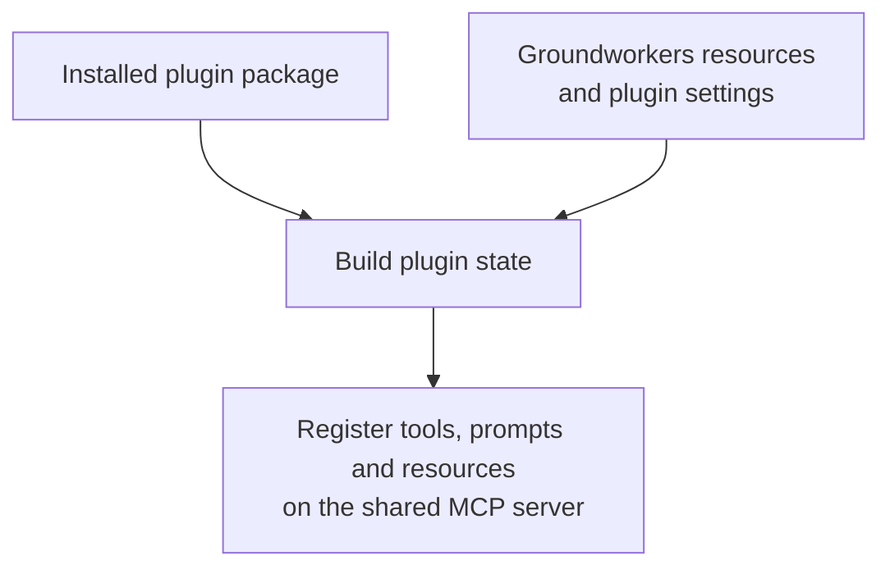

# Plugins

Plugins add specialist capabilities to a Groundworkers installation. A plugin can expose tools, prompts, and resources through the same MCP server as the core vocabulary and mapping tools. It can also provide configuration pages, readiness checks, and preparation tasks in the setup console.

Start with the [Groundworkers Plugin Catalogue](https://github.com/AustralianCancerDataNetwork/groundworkers-plugin-catalogue) to find components, installation instructions, and compatibility information. Access to the catalogue or individual component repositories may be required. Each component's own guide explains its data requirements and intended use.

## What gets installed

The ecosystem includes both executable plugins and reusable prompt content:

| Component | How it fits |
|---|---|
| Runtime plugin | A Python package that Groundworkers discovers and asks to register its MCP capabilities. |
| Installed prompt pack | A content distribution read by the OHDSI Prompt Registry plugin. It supplies instructions, schemas, or examples. |
| Filesystem prompt pack | Content read by the registry from a configured directory, often for local guidance or a working copy. |

For example, installing the Prompt Registry adds tools for finding and reading packs. Adding a pack supplies content to those tools. A pack does not need to implement the Groundworkers plugin interface itself.

The catalogue describes what you can install. Your Python environment determines what Groundworkers can discover. Configuration and available dependencies determine which capabilities can be built and used.

## How a plugin joins the host

A plugin package advertises a constructed plugin object through the `groundworkers.plugins` Python entry-point group. Groundworkers discovers that object at startup, supplies its configuration and shared resources, and asks it to build its state. It then registers the plugin's MCP tools, prompts, or resources against that state.



The plugin's service contains its own behaviour. Groundworkers provides discovery, shared runtime access, MCP registration, and common setup features. Registering MCP capabilities does not automatically create REST endpoints; REST exposes a separate set of workflows.

## The interface contract

Every runtime plugin implements four parts:

| Part | Responsibility |
|---|---|
| `name` | A stable identity, unique among installed plugins. |
| `config_cls` | The plugin's configuration schema, or `None` when no settings are needed. Its `tool_name` must match the plugin name. |
| `build(context, config)` | Use shared resources and validated plugin settings to create the state needed by the plugin. Return `None` if a required prerequisite is missing. |
| `register(server, state)` | Expose MCP tools, prompts, or resources using the state returned by `build`. |

The supplied `PluginContext` gives a plugin access to resolved CDM resources, the routed CDM session factory, and optional embedding, chat, and mapping capabilities. A plugin can reuse the host's grounding and mapping through `mapping_context`. Routed CDM sessions support installations where vocabulary tables use a different connection from clinical tables.

Plugins can also declare references to independent databases, models, or vector stores. Their settings belong in `[tools.<plugin_name>]`; connection details and credentials stay in the shared resource entries they reference. See [Configuration](usage/configuration.md#plugin-configuration) for how these settings fit into the stack.

A plugin can optionally add:

- **Readiness checks** to distinguish valid settings from usable data and services.
- **Setup steps** for explicit preparation work, with progress and logs in Runs.
- **A custom configuration flow** when its settings need more than the standard generated form.

An individual plugin can be skipped when its configuration, prerequisites, build, or registration fail, while core capabilities remain available. Plugin identities must still be unique: duplicate names are a startup error. MCP tool names also share a namespace, so plugins should prefix their tool names.

For method signatures, entry-point declarations, and authoring details, see the [plugin development guide](development/plugins.md).

## Two examples

### OHDSI Prompt Registry: exposing reusable guidance

The [OHDSI Prompt Registry](https://AustralianCancerDataNetwork.github.io/ohdsi-prompt-registry/) is a runtime plugin that publishes prompt packs through MCP. Its tools let an agent discover packs, read selected instructions or schemas, validate structured documents, and render supported results for review.

The registry can combine bundled content, separately installed pack distributions, and local filesystem packs. This lets a team share a workflow while keeping site-specific content separately maintained. Your agent conducts the conversation and applies the guidance; the registry supplies content and contract checks.

See [Working with prompts](usage/prompt-handling.md) for the user-facing model and the registry's [pack-source guide](https://AustralianCancerDataNetwork.github.io/ohdsi-prompt-registry/sources/) for configuration.

### Plugin template: a small service with tools and setup

The [Groundworkers Plugin Template](https://github.com/AustralianCancerDataNetwork/gw-plugin-template) provides a small catalogue service with list, search, and status tools. It also demonstrates a preparation step and a readiness report. It is a starting point for authors to adapt.

Its layout shows where the responsibilities belong:

| Module | Purpose |
|---|---|
| `config.py` | Declare settings and references to shared resources. |
| `adapters.py` | Read files, query databases, or call external services. |
| `service.py` | Implement behaviour that can also be called directly from Python. |
| `tools.py` | Expose that behaviour through MCP. |
| `plugin.py` | Build the components and register the plugin's capabilities. |

Longer preparation work lives separately in `setup_cli.py` and can run through the host's maintenance system. A specialised mapper can follow the same structure, reusing Groundworkers' mapping context while keeping source-specific rules and data in its own package.

## Add a plugin to your installation

1. **Check compatibility.** Use the catalogue to find the component's requirements, installation command, and recorded test evidence. A declared version range and a successful compatibility test are different kinds of evidence.
2. **Install and configure it.** Use the same Python environment that runs Groundworkers. Follow the component's guide for settings and any data preparation, then restart the host.
3. **Inspect the result.** Check registration and use the plugin's readiness checks, where available, to verify its dependencies and prepared data.

```bash
groundworkers --config-path /path/to/config.toml --describe
```

The output lists active plugins and registered capabilities, with safe issue summaries for plugins that could not be built or registered. A registered tool may still need a working connection or prepared data before a call succeeds.
