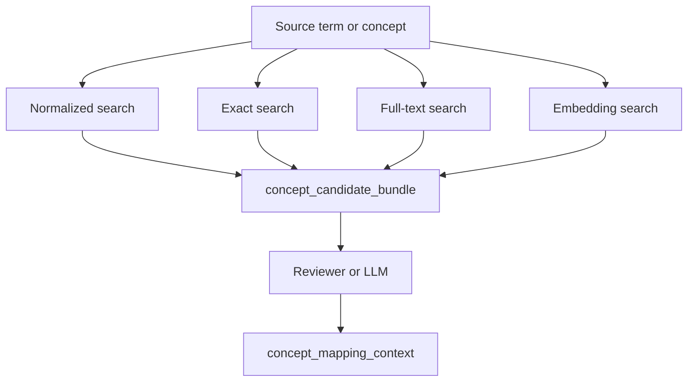

# Mapping Tools

These tools support mapping review when a single best result is not enough. They gather evidence, add context, and make candidate comparisons explicit.

## When to use these tools

Use the mapping tools when you want to:

- compare exact, normalized, full-text, and embedding retrieval side by side
- build a candidate packet for a reviewer or downstream mapping service
- ask for broader parent concepts when a hit is too specific
- assemble one context object for a chosen concept
- expand simple concept expressions
- evaluate predicted mappings against a reference set

## How they fit together



## `concept_ground` vs mapping tools

`concept_ground` is the simplest choice for a single ranked grounding result.

The mapping tools are better when you want to inspect evidence and make an explicit selection.

| If you want... | Prefer... |
|---|---|
| One best-answer grounding result | `concept_ground` |
| Multiple retrieval channels in one packet | `concept_candidate_bundle` |
| Deterministic normalized matching before ranked retrieval | `concept_search_normalized` |
| Rich context for a selected concept | `concept_mapping_context` |

## `concept_search_normalized`

Deterministic normalized equality search over concept labels, with optional synonym matching and explicit normalization metadata in the response.

```json
{
  "query": "Type-II diabetes mellitus",
  "domain": "Condition",
  "include_synonyms": false,
  "normalization_profile": "verbatim",
  "remove_stop_phrases": true
}
```

Useful response fields:

- `normalized_query`
- `normalization_steps`
- `results[*].matched_text`
- `results[*].matched_text_normalized`
- `results[*].match_mode`

## `concept_candidate_bundle`

Builds one evidence packet by combining:

- exact search
- normalized search
- full-text search
- embedding search
- optional standard mappings
- optional hierarchy preview
- optional relationship summary

```json
{
  "query": "type 2 diabetes",
  "domain": "Condition",
  "include_normalized": true,
  "include_fulltext": true,
  "include_embedding": true,
  "include_standard_mappings": true,
  "include_hierarchy_context": true
}
```

Representative response sections:

- `channels`
- `standardized_candidates`
- `candidate_union`
- `warnings`

## `concept_nearest_standard_ancestor`

Finds the nearest active standard ancestor using stored OMOP separation, abstaining on equal-distance ties. Accepts either a free-text query or an explicit `concept_id`. Useful when a source concept is too specific or non-standard and you need a broader standard parent.

```json
{
  "query": "left lower lobe lung adenocarcinoma",
  "domain": "Condition",
  "max_depth": 5
}
```

Useful response fields:

- `seed_candidates`
- `selected_parent`
- `selection_reason`
- `path_to_parent`
- `alternative_parents`

## `concept_mapping_context`

Builds one deterministic context packet for a known concept ID so the caller does not have to stitch together multiple lower-level calls.

```json
{
  "concept_id": 201826,
  "include_standard_mapping": true,
  "include_ancestors": true,
  "include_relationship_summary": true,
  "include_neighbors": true,
  "include_embedding_neighbors": true
}
```

Possible sections include:

- `concept`
- `standard_mapping`
- `ancestors`
- `descendants`
- `relationship_summary`
- `neighbors`
- `embedding_neighbors`
- `warnings`

## `concept_map_to_value`

Finds `Maps to value` relationships for a source vocabulary ID and concept code.

```json
{
  "vocabulary_id": "ICDO3",
  "concept_code": "8500/3"
}
```

## `concept_resolve_mapping_expression`

Expands a simple list of concept items with support for:

- `concept_id`
- `include_descendants`
- `exclude`

```json
{
  "items": [
    {"concept_id": 201826},
    {"concept_id": 443392, "include_descendants": true},
    {"concept_id": 320128, "exclude": true}
  ],
  "domain": "Condition",
  "deduplicate": true,
  "resolve_to_standard": true
}
```

## `mapping_evaluate_candidates`

Compares predicted mappings with a reference mapping set using `standard_concept_id` agreement.

```json
{
  "predicted_mappings": [
    {
      "source_term": "type 2 diabetes",
      "domain_id": "Condition",
      "predicted_standard_concept_ids": [201826]
    }
  ],
  "reference_mappings": [
    {
      "source_term": "type 2 diabetes",
      "domain_id": "Condition",
      "reference_standard_concept_id": 201826
    }
  ]
}
```

Useful response sections:

- `summary_metrics`
- `by_domain`
- `agreement_cases`
- `disagreement_cases`
- `missing_reference_cases`
- `extra_prediction_cases`

## Direct Python use

These workflows are also available directly through `app.services.mapping`.

```python
from groundworkers.app import build_application

app = build_application(config)
mapping = app.services.mapping

bundle = mapping.concept_candidate_bundle("type 2 diabetes", domain="Condition")
context = mapping.concept_mapping_context(201826)
```

## `concept_shared_standard_ancestor`

Read-only, deterministic common-ancestor selection for alternative concept IDs
representing one source record. It needs a configured vocabulary/graph, not an
embedding or LLM backend. Do not use separate combination ingredients as if they
were alternative product candidates.

Supply `concept_ids` (2..200 positive strict integers, at least two distinct),
`max_depth` (0..20, default 5), optional `concept_class_ids` / `vocabulary_ids`,
and display `limit` (1..50, default 10) / `offset` (default 0). Filters must use
exact installed catalogue IDs; null is unrestricted, empty/blank/unknown filters
are invalid. RxNorm alone does not include RxNorm Extension.

```json
{"concept_ids": [40166038, 41038881], "concept_class_ids": ["Clinical Drug"], "vocabulary_ids": ["RxNorm", "RxNorm Extension"], "max_depth": 5}
```

The response is `{error, code, message, data}`. On success `data.status` is
`selected`, `ambiguous`, `no_match`, or `incompatible_inputs`. `found` indicates a
unique selection, so it is false for an ancestry tie. Eligible targets must be
active standard concepts in the same domain as every input. The response echoes
constraints, complete-set counts and per-input distances for any selected target.

Distances are stored minimum separation from `CONCEPT_ANCESTOR`. Include each
seed itself at zero; retain distinct zero-separation ancestors. Such a connection
does not prove clinical interchangeability. Nearest means the lowest maximum
distance across all inputs. Equal nearest distances abstain. Display pagination
never changes that computation; `limit=1` cannot force a selection. A selected
concept is returned independently of the candidate display page.

Native MCP argument/schema errors set `isError=true`. Errors from the service
use the typed envelope with `error=true` and `data=null`. Backend failure is never
a no-match. Text and structured payloads are normalized to the same envelope.

### Ancestry consistency changes

`concept_nearest_standard_ancestor` and hierarchy previews now use the same stored
ancestry as `concept_ancestors`. Nearest-standard ties abstain instead of selecting
the first row. Query mode still starts from the first grounded candidate, which
is disclosed as `seed_selection_policy`; source-concept ambiguity remains the
agent's responsibility. Maps-to fallback is labelled `evidence_route=maps_to`,
with multiple targets left ambiguous. Missing relationship paths do not invalidate
stored ancestor evidence and are reported separately.

`concept_mapping_context` uses `ancestor_limit` only as a display count (1..50).
`ancestor_max_depth` independently sets stored separation (0..20, default 5).
`ancestor_scope` reports the full count and whether the display was truncated.
Ancestor bounds now reject invalid values rather than silently clamping them.
For the full contract and migration architecture see
[the MCP ancestry design](../development/ancestry-mcp-design.md).
