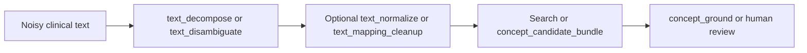

# Text tools

Text tools are optional LLM-backed preprocessing steps. They make noisy clinical input easier to retrieve; they do not select an OMOP concept or replace grounding. They are registered when a chat model is configured.

Use them only when the source text needs model-assisted interpretation. Exact, normalized, full-text, embedding, and grounding tools can be called directly when the input is already a useful clinical phrase.

## Choose the operation

| Input problem | Tool | Result |
|---|---|---|
| One abbreviation, misspelling, or lay phrase | `text_normalize` | One normalized phrase |
| One source label containing several concepts | `text_mapping_cleanup` | One cleaned search phrase that preserves the source meaning |
| A phrase containing several separate concepts | `text_decompose` | Multiple normalized terms with domain hints |
| An abbreviation with several plausible meanings | `text_disambiguate` | Ranked interpretations and context clues |

All four tools accept `text`. `domain_hint` provides model context rather than an OMOP filter. `model_name` accepts only the configured chat model or null; it does not select another model or change downstream retrieval.

The `original` fields are echoed by the model. Cleanup's `changed` flag is also model-reported: the service does not populate those fields by copying the input or comparing strings. Normalization and cleanup return categorical confidence (`high`, `medium`, or `low`) and optional notes about ambiguity.

## `text_normalize`

```json
{
  "text": "DM2",
  "domain_hint": "Condition"
}
```

Typical response:

```json
{
  "normalized": "Type 2 diabetes mellitus",
  "original": "DM2",
  "confidence": "high",
  "notes": null
}
```

Use this for one term. For a multi-concept phrase, use `text_decompose`; for known ambiguity, use `text_disambiguate`.

## `text_mapping_cleanup`

Rewrites a source label into one search phrase while retaining meaning and removing formatting noise, score prefixes, duplicated fragments, or value-label boilerplate when the supplied context shows it is not essential.

```json
{
  "text": "1 - Current smoker",
  "context": {"parent_label": "Smoking status"},
  "domain_hint": "Observation"
}
```

The response contains `replacement`, `original`, `changed`, `confidence`, and optional `notes`. Use this when the source item should remain one mapping target; use `text_decompose` when it contains several concepts.

## `text_decompose`

```json
{
  "text": "patient with T2DM and HTN on metformin",
  "max_terms": 10
}
```

Typical response:

```json
{
  "terms": [
    {"term": "Type 2 diabetes mellitus", "domain_hint": "Condition"},
    {"term": "Hypertension", "domain_hint": "Condition"},
    {"term": "Metformin", "domain_hint": "Drug"}
  ],
  "original": "patient with T2DM and HTN on metformin"
}
```

Pass each returned term and its domain hint to a search, candidate-bundle, or grounding call. `max_terms` defaults to 10; the requested count is clamped to 1–20 in the prompt, and the returned list is not truncated by code.

## `text_disambiguate`

```json
{"text": "MS"}
```

The response contains ranked `interpretations`, each with an optional `domain_hint` and `context_clues`, plus `is_ambiguous`. Present these alternatives to a caller or reviewer when context is insufficient to choose one interpretation safely. `max_interpretations` defaults to 5; the requested count is clamped to 1–10 in the prompt, and the returned list is not truncated by code. Ranking is requested from likely use in context, or common clinical use when context is absent; no frequency data or numerical rank score is used.

## Errors

| Code | Meaning |
|---|---|
| `INVALID_INPUT` | Empty or whitespace-only text, returned before the model is called |
| `BACKEND_UNAVAIL` | The configured LLM endpoint is unavailable or unauthenticated |
| `QUERY_ERROR` | The model request failed or its structured response could not be parsed |

## Typical flow



The LLM output is an input to retrieval, not a mapping decision. Keep the model's confidence and notes available if a later reviewer needs to understand how the search phrase was produced.
